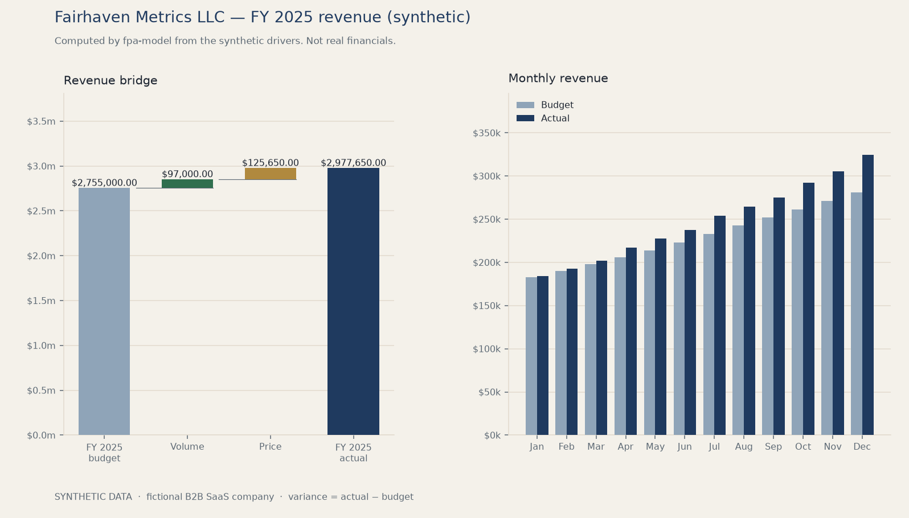
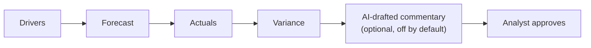

# fpa-driver-model

A driver-based FP&A model for a fictional B2B SaaS company: roll a 2026 forecast from monthly drivers, compare 2025 actuals with the original budget, and keep the variance write-up off until an analyst asks for a draft and approves it.

[](https://github.com/tishan-perera/fpa-driver-model/actions/workflows/ci.yml)




## Quick start

These commands use the files in the repository. They do not ask for an API key.

```bash
git clone https://github.com/tishan-perera/fpa-driver-model
cd fpa-driver-model
python3 -m venv .venv && source .venv/bin/activate
pip install -e .
fpa-model run
fpa-model verify
```

`fpa-model run` rolls the forecast, prints actual versus budget, and prints the 12 checks. Commentary stays off. `fpa-model verify` recomputes the workbook from its input tabs, checks those results against [data/synthetic/test_cases.md](data/synthetic/test_cases.md), then evaluates the formula cells and checks them against the Python model.

Regenerate the chart above with:

```bash
fpa-model chart --output docs/fy2025-revenue-bridge.png
```

Optional commentary, still with no API key:

```bash
fpa-model run --draft-commentary -o draft.md
fpa-model status draft.md
fpa-model approve draft.md --reviewer "Your name" --note "Bridge ties to the model."
fpa-model status draft.md
```

An unapproved example of that draft is in [examples/draft-commentary.md](examples/draft-commentary.md). It was written by `draft_commentary()` from the model. It is not an approval.

## How a run moves



Read the diagram as the path an analyst walks. The 2025 actuals and the 2025 budget are stored inputs. The 2026 forecast is rolled from the monthly drivers, and January 2026 opens at December 2025 ending customers. Variance is actual minus budget. The commentary step does not run unless you pass `--draft-commentary`. `fpa-model status` stays `pending` until you record a decision, and editing the draft after that decision makes it `stale`.

## What this shows an FP&A hiring manager

This is a portfolio demo of the mechanics of a driver model. It is not a description of a job held, and it is not a live forecast.

| Piece | What is in the repo |
| --- | --- |
| Driver forecast | New customers, churn, monthly ARPA, headcount, cost per head, and other opex roll a full year |
| Revenue definition | Average customers times monthly ARPA, not ending customers |
| Cost stack | COGS at 20% of revenue, people cost by department, other opex, operating income |
| Variance | Actual minus budget, with the sign stated for revenue and for cost |
| Bridge | Volume at each month's budgeted ARPA, and price, summed back to the revenue variance |
| Review | Commentary is off by default. A draft can be approved or rejected, and an edit invalidates the decision |
| Tie-out | Twelve checks, an independent read of the workbook inputs, and an evaluation of the formula cells |

The chart at the top is one run of `fpa-model chart`. The axis labels and the bar labels are formatted from that run. `fpa-model run` prints the same model.

## Rules the model uses

- Ending customers = beginning customers + new customers − churned customers.
- Average customers = (beginning + ending) / 2.
- Revenue = average customers × monthly ARPA. ARPA here is monthly, in USD.
- COGS = revenue × 20%.
- People cost is headcount times cost per head for Engineering, Sales, Customer Success, and G&A.
- Total opex = people cost + other opex.
- Operating income = gross profit − total opex.
- ARR on a month = ending customers × that month's ARPA × 12.
- Variance $ = actual − budget. A positive revenue or operating-income variance is favorable. A positive cost variance is unfavorable.
- 2026 cost per head is 3% above the 2025 rate, rounded half-up to the cent.

Flow items (new and churned customers, revenue, cost, profit, operating income) sum across the year. Beginning and ending customers, average customers, ARPA, headcount, and cost per head do not.

The company is Fairhaven Metrics LLC, a fictional B2B SaaS company. Currency is USD. The year is a calendar year. Departments are Engineering, Sales, Customer Success, and G&A.

## Workbook

[data/synthetic/Fairhaven_Metrics_FP&A_Model_SYNTHETIC_built.xlsx](<data/synthetic/Fairhaven_Metrics_FP&A_Model_SYNTHETIC_built.xlsx>) has five tabs: Inputs-Drivers, Actuals, Forecast, Budget-vs-Actual, and Summary. Every tab starts with a SYNTHETIC DATA banner. Forecast, Budget-vs-Actual, and Summary are formula-driven. Actuals and the driver inputs are values.

`fpa-model verify` does two passes. The first reads the stored inputs and recomputes the identities without using the Python model's check list. The second evaluates the formula cells (references, arithmetic, and SUM) and compares them with the Python model. CI does not install Excel.

## Limits

- One fictional company, one product, four departments, and one COGS rate.
- No tax, debt, capex, cash, bookings, working capital, or FX.
- No ERP, ledger, or other live system.
- The commentary step fills a fixed draft from the computed bridge. It does not call a hosted model.
- A draft is not the commentary until an analyst approves that exact text.
- The workbook formulas are checked by the in-repo evaluator. CI does not open Excel.
- Do not use these figures in a filing, a live close, or a conversation as if they were a real company's results.

## Synthetic data

**SYNTHETIC DATA.** Fairhaven Metrics LLC is fictional. The actuals, the budget, the drivers, the chart, and the draft commentary are not real financials, not a client or employer close, and not a production forecast. Do not use them in a live finance process.

The driver inputs live in `src/fpa_driver_model/synthetic.py`. [data/synthetic/test_cases.md](data/synthetic/test_cases.md) is rendered from that model. The workbook carries the same inputs, and the tests fail if the workbook and the model diverge. A figure on the chart or in the draft is formatted from a run of this code.

## Repository layout

| Path | What it is |
| --- | --- |
| `src/fpa_driver_model/` | Roll-forward, variance bridge, local draft, approval record, chart, verifier, formula tie-out, CLI |
| `data/synthetic/` | The workbook and the 12 checks |
| `examples/draft-commentary.md` | One unapproved draft produced by the model |
| `docs/fy2025-revenue-bridge.png` | The chart from `fpa-model chart` |
| `tests/` | Identities, the verifier, the formula tie-out, review, and a secret-shaped text scan |
| `.github/workflows/ci.yml` | Tests on Python 3.11–3.13, ruff, and gitleaks |

## Development

```bash
pip install -e ".[dev]"
pytest
ruff check src tests
ruff format --check src tests
fpa-model verify
```

## License

MIT. Copyright (c) 2026 Tishan Perera. The fictional demo data may be reused. See [LICENSE](LICENSE).
